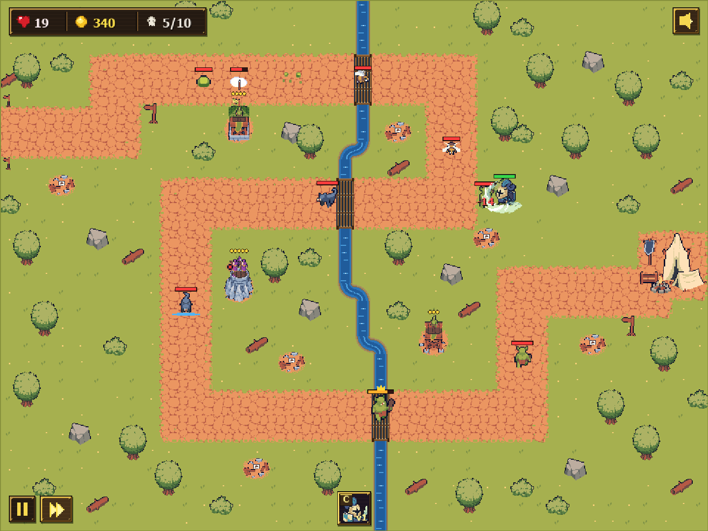

# Королевство в опасности (Kingdom in Danger)

2D-игра в жанре **Tower Defense + RTS** на Python и `pygame-ce`.  
Защитите Командный лагерь от 10 волн врагов, сочетая тактическую застройку башнями с прямым управлением Рыцарем-командиром на карте `40 × 30` тайлов (`960 × 720` → `1440 × 1080`).



## Основные возможности

- **RTS-управление командиром:** Рыцарь перемещается по **ПКМ** с помощью алгоритма поиска пути **A\*** по сетке карты, обходя препятствия, реку и башни, и автоматически вступает в ближний бой (до 2 врагов одновременно, с чередованием атак и повышением уровня за опыт).
- **2 типа башен (по 7 уровней апгрейда):**
  - **Башня лучников** — высокая скорострельность и точечный урон стрелами.
  - **Башня магов** — магические сферы со сплеш-уроном по площади, замедлением и пробитием брони.
- **4 вида врагов и боссы волн:**
  - *Слизень* — слабый массовый враг для ранних волн.
  - *Гигантская пчела* — быстрый лёгкий противник.
  - *Свирепый волк* — стремительный хищник ближнего боя.
  - *Гоблин с дубиной* — прочный боец; на 5-й и 10-й волнах выходят усиленные боссы (*Вожак гоблинов* и *Король гоблинов*).
- **Интерфейс и визуализация:** главное меню, выбор командира, таблица рекордов (Топ-5), карточка героя (`C`), пауза (`P`), ускорение `1x / 2x` (`Пробел`), радиусы башен, полоски HP, всплывающий урон/золото/опыт, частицы и процедурный звук.

## Управление

| Клавиша / Кнопка | Действие |
| --- | --- |
| **ПКМ** | Отправить Рыцаря-командира в точку карты (поиск пути A*) |
| **ЛКМ** | Постройка, улучшение (`1–7` ур.) и продажа башен, клики в меню и HUD |
| **`C`** | Открыть / закрыть карточку характеристик командира |
| **`Пробел`** / **`>>`** | Запустить следующую волну или переключить скорость `1x / 2x` |
| **`P`** / **`\|\|`** | Пауза / продолжение игры |
| **`Esc`** | Закрыть меню постройки / карточку, переключить паузу или вернуться в главное меню |

## Требования

- **Python** 3.10+ (проверено на Python 3.14)
- **pygame-ce** (`>= 2.5.0`, указано в [`requirements.txt`](requirements.txt))

## Установка и запуск

### Способ 1: Быстрый запуск на Windows (`start.bat`)

Дважды кликните по [`start.bat`](start.bat) или запустите его из командной строки — скрипт сам проверит наличие Python, установит `pygame-ce` из `requirements.txt` (если не установлен) и запустит игру.

### Способ 2: Запуск через терминал (`python main.py`)

```bash
# 1. Создать и активировать виртуальное окружение (рекомендуется)
python -m venv .venv
# Windows (PowerShell / CMD):
.venv\Scripts\activate
# Linux / macOS:
# source .venv/bin/activate

# 2. Установить зависимости
pip install -r requirements.txt

# 3. Запустить игру
python main.py
```

## Проверка и автотесты

```bash
python tests/test_stage5.py
python tests/test_stage6.py
python tests/test_stage7.py
python main.py --test-run 120
```

## Структура проекта

```text
├── main.py                # Точка входа и основной игровой цикл
├── settings.py            # Константы экрана, баланса, башен, врагов и 10 волн
├── requirements.txt       # Зависимости проекта (pygame-ce)
├── start.bat              # Лаунчер для быстрого запуска на Windows
├── core/                  # Логика карты, сетка, A*, менеджер волн, ассеты и звук
├── entities/              # Рыцарь-командир, башни, враги и снаряды
├── ui/                    # Главное меню, плавающий HUD, карточка героя, рекорды
├── vfx/                   # Частицы, всплывающие цифры, тряска камеры
├── assets/                # Пиксель-арт спрайты (тайлсеты, герой, башни, враги)
├── docs/                  # Материалы для README (превью-скриншот)
└── tests/                 # Автотесты механик, экономики, башен, врагов и UI
```
